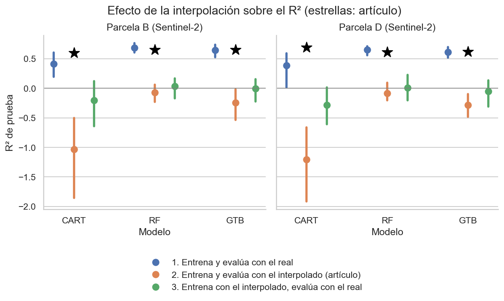
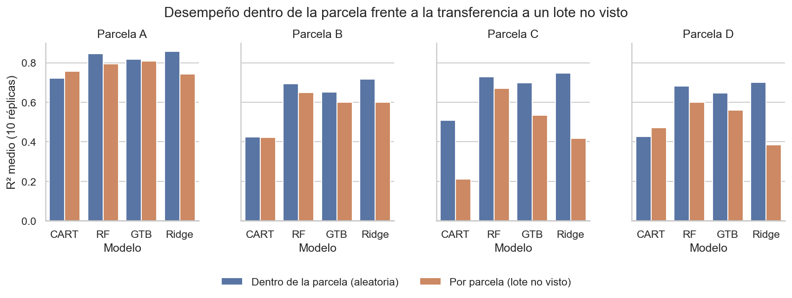

# Recreación con datos simulados: predicción del rendimiento de papa con Sentinel-2 y aprendizaje de máquina

**Trabajo final — Machine Learning II**\
Maestría en Analítica Aplicada e Inteligencia Artificial, Universidad de La Sabana\
Profesor: Jesús Antonio Villarraga Palomino\
Autora: Isabel Cristina Morales Parra

---

## 1. Descripción

Este repositorio recrea, mediante datos simulados, el análisis de un artículo científico sobre predicción del rendimiento de papa con imágenes satelitales y aprendizaje de máquina. El propósito no es reproducir exactamente los resultados originales, sino aproximarse a su procedimiento, comparar los resultados obtenidos con los reportados, analizar las diferencias y evaluar, mediante una extensión experimental, cómo cambia el desempeño de los modelos al modificar una condición del experimento: el **esquema de validación**, con énfasis en la **fuga de información**.

## 2. Artículo de referencia

Imtiaz, F., Farooque, A. A., Randhawa, G. S., Wang, X., Esau, T. J., Hashemi Garmdareh, S. E. y Acharya, B. (2025). Optimizing potato yield mapping and prediction: Integrating satellite-based remote sensing and machine learning for sustainable agriculture. *Computers and Electronics in Agriculture, 237*, 110636. https://doi.org/10.1016/j.compag.2025.110636

Una copia del artículo se encuentra en `references/`, distribuida bajo la licencia CC BY-NC-ND 4.0 de sus autores. La lectura crítica completa (fuentes de cada dato y 13 hallazgos) está en `references/ficha_extraccion.md`.

**Síntesis del estudio original:** cuatro parcelas de papa en la Isla del Príncipe Eduardo (Canadá), temporadas 2021 y 2022. Rendimiento medido con cosechadora (parcelas A y C) o por excavación manual en 30 puntos e interpolado por IDW (B y D). Predictores: cuatro bandas (azul, verde, rojo e infrarrojo cercano) y cuatro índices de vegetación (NDVI, GNDVI, EVI y SAVI) de Sentinel-2A y PlanetScope. Modelos: CART, bosque aleatorio (RF) y Gradient Tree Boosting (GTB). Métricas: R², RMSE y MAE, con una partición aleatoria 70/30 por parcela.

## 3. Relación con el trabajo de grado

El trabajo de grado de la autora busca predecir el rendimiento y la producción de papa en el corredor Bogotá–Tunja (Cundinamarca y Boyacá) a partir de imágenes satelitales e información histórica. Este ejercicio sirve como piloto metodológico de esa línea de investigación: emplea el mismo cultivo, el mismo sensor (Sentinel-2) y una formulación equivalente del problema como regresión, y sus conclusiones sobre validación y calidad del dato de verdad de terreno se trasladan directamente al diseño de la tesis (sección 10).

## 4. Estructura del repositorio

```
proyecto_ml_final/
├── README.md
├── environment.yml                     # Entorno reproducible (versiones fijadas)
├── data/
│   └── datos_simulados.csv             # Base simulada definitiva (semilla 42)
├── notebooks/
│   ├── 01_simulacion_datos.ipynb       # Simulación y validación univariada y multivariada
│   ├── 02_analisis_articulo.ipynb      # Recreación con 30 réplicas y comparación
│   └── 03_extension_experimental.ipynb # Extensión: fuga de información
├── src/
│   ├── config.py                       # Parámetros, con su origen [R], [F], [D] o [S]
│   ├── simulacion.py                   # Generador espacial de datos
│   ├── modelos.py                      # CART, RF y GTB del artículo; Ridge como línea base
│   ├── evaluacion.py                   # Métricas y procedimiento del artículo
│   ├── calibracion.py                  # Calibración del ruido frente a las Tablas 4 y 5
│   └── validacion.py                   # Esquemas de validación y experimentos de la extensión
├── results/                            # Tablas de resultados (CSV)
├── figures/                            # Gráficas generadas
└── references/
    ├── Imtiaz_et_al_2025.pdf
    └── ficha_extraccion.md             # Lectura crítica del artículo
```

## 5. Instalación

Requisitos previos: [Git](https://git-scm.com/) y [Miniconda](https://docs.conda.io/en/latest/miniconda.html) o Anaconda.

```bash
git clone https://github.com/isabelmorales2108-ux/proyecto_ml_final.git
cd proyecto_ml_final
conda env create -f environment.yml
conda activate ml2_papa
python -m ipykernel install --user --name ml2_papa --display-name "Python (ml2_papa)"
```

El último comando registra el entorno para que aparezca como kernel en Jupyter y VS Code.

## 6. Orden de ejecución

Ejecutar los notebooks en orden, con el kernel **Python (ml2_papa)**:

| Notebook | Propósito | Tiempo aproximado* |
|---|---|---|
| `01_simulacion_datos.ipynb` | Genera la base simulada y la valida con análisis univariado y multivariado | 1 minuto |
| `02_analisis_articulo.ipynb` | Recrea el procedimiento del artículo con 30 réplicas y compara con las Tablas 4, 5 y 7 | 15 minutos |
| `03_extension_experimental.ipynb` | Compara esquemas de validación, sensibilidad al alcance y selección de hiperparámetros | 45 minutos |

\* Tiempos de la primera ejecución en un equipo de 16 hilos. Los resultados de los cálculos largos se guardan en `results/`; si el archivo correspondiente existe, los notebooks lo leen en segundos sin volver a entrenar. Para recalcular, se elimina el archivo o se usa el argumento `recalcular=True`.

Si se modifica algún archivo de `src/` con un notebook abierto, debe reiniciarse el kernel antes de continuar.

## 7. Reproducibilidad

- Versiones de paquetes fijadas en `environment.yml` (Python 3.11, numpy 2.4.6, pandas 3.0.6, scipy 1.17.1, scikit-learn 1.8.0, seaborn 0.13.2, plotly 6.7.0).
- Semilla base `config.SEMILLA = 42`; cada réplica usa `42 + número de réplica`.
- La base publicada en `data/` se regenera idéntica con el notebook 01 (se verifica en la sección 2 del notebook).
- Pequeñas diferencias en CART y GTB entre versiones de scikit-learn se deben al desempate interno de los árboles; por eso las versiones están fijadas.

## 8. Supuestos de la simulación

Cada parámetro de `src/config.py` está marcado según su origen: **[R]** reportado, **[F]** estimado de figura, **[D]** derivado de resultados reportados, **[S]** supuesto.

| Elemento | Supuesto | Justificación |
|---|---|---|
| Lote | Cuadrado de 390 m (15,2 ha) | Las parcelas del artículo miden 15–16 ha [R] |
| Rendimiento por parcela | Media [F], desviación [D] y límites [F]; asimetría positiva en A [S] | Figuras 6, 7 y 10; varianza implícita en las Tablas 4 y 5 |
| Estructura espacial | Correlación exponencial con alcance de 40 m y pepita de 0,20 [S] | Manchas de rendimiento de 30 a 50 m, según criterio agronómico |
| Mediciones manuales (B y D) | 30 puntos en 3 franjas con grillas de 5 × 2; interpolación IDW con potencia 2 [S] | El artículo indica 3 zonas × 10 puntos e IDW, sin detallar la ubicación ni los parámetros |
| Cobertura del dosel | Curva logística del rendimiento con saturación moderada [S] | El compuesto estacional (junio–septiembre) promedia fases de cobertura parcial y dosel cerrado |
| Bandas | Mezcla lineal de follaje y suelo de la serie Charlottetown, entre húmedo y seco [S] | Valores típicos de la literatura, validados con criterio agronómico |
| Índices | Calculados con sus fórmulas; EVI con 7,5 × Azul [S] | Formulación estándar; el artículo escribe 7 (hallazgo 8) |
| Ruido | Desacople dosel–rendimiento (0,35), ruido del sensor (2,0 % Sentinel-2; 2,5 % PlanetScope), brillo del suelo e iluminación (3 %) [S] | Calibrado con las parcelas A y C frente a las Tablas 4 y 5 (diferencia media de R² de 0,038) |
| Estrategias | Univariada (solo relaciones de cada predictor con la respuesta) y multivariada (con fuentes de variación compartidas entre bandas) | Análisis "una contra una" y "todas contra todas" |
| Hiperparámetros no reportados | Valores por defecto de Google Earth Engine, verificados en su documentación [S] | Los autores declaran haber ajustado solo los de la Tabla 3 |

## 9. Resultados principales

**Recreación (notebook 02).** En las parcelas de cosechadora (A y C), 8 de 12 valores de R² del artículo quedan dentro del intervalo del 95 % de 30 réplicas. En las parcelas de excavación (B y D), el procedimiento declarado (respuesta interpolada desde 30 mediciones) produce R² negativos; los R² del artículo (0,60–0,69) solo se reproducen con mediciones directas.



**Lectura crítica.** En ninguna combinación los tres modelos del artículo se evaluaron con la ecuación 5 sobre un mismo conjunto de prueba (hallazgo 1); los R² de entrenamiento reportados no son reproducibles por resustitución (hallazgo 13); y las diferencias entre sensores de la Tabla 7 son compatibles con el azar de una sola partición (hallazgo 9).

**Extensión (notebook 03).** Con mediciones directas, la validación aleatoria no infla el desempeño; con la respuesta interpolada, lo infla en ~0,10. Ridge es el mejor modelo dentro de cada parcela, pero RF es el más robusto al transferir a un lote no visto. La selección de hiperparámetros mirando el conjunto de prueba siempre infla el desempeño, aunque poco en este diseño (0,003–0,010).



## 10. Conclusiones y aprendizajes

### ¿Qué se logró recrear?

- El procedimiento completo del artículo: partición 70/30 por parcela, ocho predictores, CART, RF y GTB con los hiperparámetros de la Tabla 3 y los valores por defecto de Google Earth Engine, y métricas R², RMSE y MAE.
- Las características de los datos que más influyen en el desempeño: nivel y dispersión del rendimiento, saturación de los índices en parcelas de alto rendimiento y correlaciones índice–rendimiento dentro de cada parcela.
- El desempeño en las parcelas de cosechadora y, con mediciones directas, en las de excavación.

### ¿Qué no fue posible recrear?

- Los R² de B y D con la respuesta interpolada, aun con manchas de rendimiento de 150 m.
- El orden de los modelos: en la simulación, RF y GTB superan a CART; en el artículo rinden parecido.
- Los R² de entrenamiento y la coherencia entre R² y RMSE reportados.

### ¿Qué se aprendió sobre el método?

- Una sola partición no permite comparar modelos ni sensores: la variación entre réplicas (hasta ±0,16 de R²) es del mismo orden que las diferencias que el artículo interpreta.
- El dato de verdad de terreno pesa más que el algoritmo: con los mismos predictores y modelos, el R² pasa de 0,6–0,7 a 0 según la respuesta sea una medición directa o una interpolación desde 30 puntos.
- El RMSE por sí solo puede engañar cuando la variabilidad de la respuesta cambia entre escenarios.
- Un modelo lineal puede igualar a los árboles; la complejidad debe justificarse frente a una línea base simple.
- Los índices normalizados son más robustos que las bandas individuales frente a fuentes de variación compartidas.

### ¿Cómo afecta la condición experimental el desempeño?

- Con mediciones directas, el esquema de validación casi no cambia el resultado.
- Con la respuesta interpolada, la validación aleatoria infla el R² en ~0,10.
- Al transferir a un lote no visto, el desempeño cae y el mejor modelo cambia (Ridge cae hasta 0,33 de R²; RF solo 0,05–0,08).
- La selección de hiperparámetros con fuga siempre infla el desempeño, y el ajuste no mejora los valores de la Tabla 3.

### Implicaciones para el trabajo de grado

1. Validar como se usará el modelo: dejar municipios completos fuera del entrenamiento si el modelo se aplicará a municipios nuevos.
2. Cuidar la escala y la calidad de la variable respuesta: el rendimiento municipal de las EVA es agregado, mientras los predictores de Sentinel-2 tienen 10 m de resolución.
3. Incluir siempre una línea base simple antes de justificar modelos complejos.
4. Reportar la incertidumbre con réplicas, validación cruzada e intervalos de confianza.
5. Elegir hiperparámetros con validación anidada y reservar un conjunto de prueba que no se use para decidir.
6. Sentinel-2 es suficiente: rinde de forma comparable a un sensor comercial de mayor resolución y es gratuito.
7. La simulación es una herramienta de diseño: permite anticipar tamaños de muestra, esquemas de validación y sensibilidad a los supuestos antes de recolectar datos reales.

### Limitaciones

- El generador no incluye ruido del sensor con estructura espacial (suavidad de los predictores), que podría explicar los R² del artículo en B y D.
- Las parcelas A y C comparten una misma curva de cobertura, aunque corresponden a años distintos.
- La zona de exclusión de 40 m es insuficiente para el alcance de 150 m.
- La extensión se acotó a Sentinel-2, estrategia multivariada y 5–10 réplicas por costo de cómputo.

## Licencia y uso

Código desarrollado con fines académicos. El artículo de referencia es propiedad de sus autores y se distribuye bajo la licencia [CC BY-NC-ND 4.0](https://creativecommons.org/licenses/by-nc-nd/4.0/).
